# From the antenna to the speaker

How tvheadend turns 4 MB/s of raw radio samples from an RTL‑SDR stick into a 72 kbit/s HE‑AAC stream that Kodi plays. The page follows every stage, names the files and functions involved, and lists each optimization with what it saved.

| | |
|---|---|
| **2.048 MS/s** | 8‑bit I/Q from the stick = 4.1 MB/s |
| **96 ms** | one DAB transmission frame (mode I) |
| **1536** | carriers, 1 kHz apart, DQPSK |
| **≈ 0.5 s** | pipeline latency (time interleaver + superframe) |
| **≈ 55 %** | of one Raspberry Pi 3 core, all three threads together |

## Contents

- [00 · The whole journey](#00--the-whole-journey)
- [01 · Three threads, one pipeline](#01--three-threads-one-pipeline)
- [02 · Anatomy of a 96 ms frame](#02--anatomy-of-a-96-ms-frame)
- [03 · What the signal looks like](#03--what-the-signal-looks-like)
- [04 · Stage 1 · Stick, USB and the ring buffer](#04--stage-1--stick-usb-and-the-ring-buffer)
- [05 · Stage 2 · Bytes become complex samples](#05--stage-2--bytes-become-complex-samples)
- [06 · Stage 3 · Finding the frame: time and frequency sync](#06--stage-3--finding-the-frame-time-and-frequency-sync)
- [07 · Stage 4 · OFDM: from time samples to soft bits](#07--stage-4--ofdm-from-time-samples-to-soft-bits)
- [08 · Stage 5 · FIC: the table of contents](#08--stage-5--fic-the-table-of-contents)
- [09 · Stage 6 · MSC: cut out one station and undo the protection](#09--stage-6--msc-cut-out-one-station-and-undo-the-protection)
- [10 · Stage 7 · DAB+ audio: superframe, Reed‑Solomon, access units](#10--stage-7--dab-audio-superframe-reedsolomon-access-units)
- [11 · Stage 8 · Into tvheadend, over HTSP, out of the speaker](#11--stage-8--into-tvheadend-over-htsp-out-of-the-speaker)
- [12 · Where the time goes](#12--where-the-time-goes)
- [13 · Optimizations at a glance](#13--optimizations-at-a-glance)

## 00 · The whole journey

Eight stages, three threads inside tvheadend, and one decoder in the client. Each colour stays the same throughout the page.

The time interleaver (16 CIFs = 360 ms) and the audio superframe (120 ms) make up most of the ≈ 0.5 s between air and loudspeaker.

## 01 · Three threads, one pipeline

The work is split so that the slow parts overlap. The USB thread only copies bytes. The demodulator thread keeps the frame timing and hands every OFDM symbol, as raw time samples, to the OFDM thread, which does all the heavy maths: FFT, demodulation and every Viterbi and Reed‑Solomon decoder.

CPU per thread measured with `top -H` on a Raspberry Pi 3 (1.2 GHz Cortex‑A53, 32‑bit build without NEON) while playing one station, after [PR #18](https://github.com/mwalliczek/tvheadend/pull/18). 100 % is one full core.

**Code:**

- [`rtlsdr_dab_frontend.c`](../../src/input/dab/rtlsdr/rtlsdr_dab_frontend.c): `rtlsdr_read_thread_fn · rtlsdr_dab_callback · rtlsdr_frontend_monitor`
- [`sdr_dab_basic_demodulation.c`](../../src/input/dab/rtlsdr/sdr_dab_basic_demodulation.c): `rtlsdr_demod_thread_fn`
- [`ofdmDecoder.c`](../../src/input/dab/rtlsdr/ofdmDecoder.c): `decodeBlock · acquireBuffer · releaseBuffer · run_thread_fn`

> **Why a separate OFDM thread?** A 96 ms frame must be processed in 96 ms or the FIFO overflows. In one thread the demodulator would wait while the FFT and the Viterbi decoder run. With the hand‑off, the demodulator already reads symbol *n+1* while symbol *n* is decoded, and on a multi‑core Pi the two run on different cores. `acquireBuffer` gives each of the 76 symbol slots its own buffer, so the demodulator only blocks if the OFDM thread falls a whole frame behind.

## 02 · Anatomy of a 96 ms frame

DAB transmission mode I sends a frame every 96 ms: a null symbol (the transmitter is silent), the phase reference symbol, 3 symbols of the **Fast Information Channel** (FIC: what is on air), and 72 symbols of the **Main Service Channel** (MSC: the audio of all stations), grouped into four 24 ms **Common Interleaved Frames** (CIFs).

**Code:**

- [`dab.h`](../../src/input/dab.h): `T_F 196608 · T_null 2656 · T_s 2552 · T_u 2048 · T_g 504 · K 1536 · L 76 · CUSize 64`

## 03 · What the signal looks like

Before following the code, it helps to see the signal itself: what an OFDM symbol is, what the stick actually sends over USB, and how the numbers turn into four clean clouds of points. Plots marked *(recorded)* use real data from the test fixtures (`tests/input/dab/rtlsdr/`), captured from an RTL‑SDR stick. Plots marked *(simulated)* were computed with the DAB mode I parameters.

### 3.1 · 1536 carriers make one signal

Each carrier is a sine wave at a multiple of 1 kHz. It carries two bits in its **phase**: one of four angles, 45°, 135°, 225° or 315°. The transmitter adds all carriers together; that sum is the OFDM symbol. Below are two snapshots, with 4 and with 1536 carriers: with a handful you can still see the waves, and with 1536 the sum looks like pure noise. The information is still there, and an FFT pulls the carriers apart again.

Top: the individual carriers, real part, over one useful period Tu = 1 ms (shown up to 8). Middle: their sum, which is what goes on air: I = real part, Q = imaginary part. Bottom: the spectrum, one line per carrier, each with an arrow for its phase, i.e. its two bits.

### 3.2 · A frame in time *(simulated)*

The only structure you can see with the naked eye is the null symbol: the transmitter is off for 1.3 ms. That dip is what `rtlsdr_demod_thread_fn` looks for first. Everything after it has a constant envelope on average and looks like noise in I and Q.

### 3.3 · What the stick delivers *(recorded)*

The stick has no notion of carriers or symbols. It sends a plain stream of bytes, alternating I and Q, with 128 meaning zero. These are the real first bytes of `input_sdrTest/rtlsdr_raw`:

| n | I byte | Q byte | on the wire | I float | Q float | complex x[n] | \|x\| | angle |
|---|---|---|---|---|---|---|---|---|
| 0 | 108 | 122 | 0x6C 0x7A | -0.1562 | -0.0469 | -0.156 − 0.047j | 0.163 | -163° |
| 1 | 112 | 139 | 0x70 0x8B | -0.1250 | +0.0859 | -0.125 + 0.086j | 0.152 | +145° |
| 2 | 134 | 135 | 0x86 0x87 | +0.0469 | +0.0547 | +0.047 + 0.055j | 0.072 | +49° |
| 3 | 114 | 115 | 0x72 0x73 | -0.1094 | -0.1016 | -0.109 − 0.102j | 0.149 | -137° |
| 4 | 130 | 109 | 0x82 0x6D | +0.0156 | -0.1484 | +0.016 − 0.148j | 0.149 | -84° |
| 5 | 143 | 120 | 0x8F 0x78 | +0.1172 | -0.0625 | +0.117 − 0.062j | 0.133 | -28° |
| 6 | 121 | 124 | 0x79 0x7C | -0.0547 | -0.0312 | -0.055 − 0.031j | 0.063 | -150° |
| 7 | 149 | 122 | 0x95 0x7A | +0.1641 | -0.0469 | +0.164 − 0.047j | 0.171 | -16° |

The conversion is a table lookup: `convTable[b] = (b − 128)/128`, so `x[n] = convTable[I] + j·convTable[Q]`. Then `getSamples` multiplies by the oscillator e−j2πfn/2048000 to cancel the frequency error. This is the 16.4 MB/s stream of `float _Complex` that the demodulator works on.

### 3.4 · What I and Q mean physically

At every sampling instant, I and Q are **two coordinates of the radio wave**: its amplitude and its phase relative to a reference oscillator tuned exactly to the centre of the channel. Near the tuned frequency fc the antenna voltage is a cosine whose amplitude and phase change only slowly: `v(t) = A(t)·cos(2π f_c t + φ(t))`. Any such wave can be written as a cosine part plus a sine part at fc: `v(t) = I(t)·cos(2π f_c t) − Q(t)·sin(2π f_c t)`. I (in‑phase) says how much of the signal lines up with the cosine, Q (quadrature) how much lines up with the sine, a quarter period later. The fast carrier is dropped; I and Q change only as fast as the information does.

### Inside the stick

The stick does not have two analog converters. The R820T tuner amplifies the antenna signal and moves the channel down to a low intermediate frequency (IF) of about 3.57 MHz, still a single real voltage. The RTL2832U digitizes it with one 8‑bit ADC at 28.8 MHz, then multiplies digitally by a cosine and by a minus sine at the IF. Each product is low‑pass filtered and resampled to 2.048 MS/s. Those two results are the I and Q bytes. 128 means 0; the scale depends on the gain, so the values are relative. `|x|²` is proportional to the received power, which is where the level and SNR figures come from.

### Why two numbers? Positive and negative frequencies

With only I, a carrier 3 kHz above fc and one 3 kHz below would give identical samples, because a real signal cannot tell +f from −f. As a complex number they rotate in opposite directions: +f counter‑clockwise, −f clockwise, and a carrier exactly at fc stands still. That is why 2.048 million complex samples per second cover the full ±1.024 MHz around the centre, enough for the 1.536 MHz DAB block.

The I traces of +3 kHz and −3 kHz are identical; only Q shows which side of the centre the carrier is on. In the FFT every bin is such a phasor rotating k turns per millisecond, and its angle carries the bits. A stick crystal off by −47 ppm puts the oscillator 9.6 kHz off, so *every* phasor gains 9.6 extra turns per millisecond. The oscillator in `getSamples` (`e^(−j2πfn/2048000)`) turns them back.

### 3.5 · The guard interval, visible in the waveform *(simulated)*

Each symbol starts with a copy of its own last 504 samples. Because of this repetition, an echo that arrives up to 246 µs late only shifts the window cyclically and does not mix two symbols. `rtlsdr_demod_thread_fn` correlates the two copies (`FreqCorr`) to measure the fine frequency error.

### 3.6 · The same symbol in the frequency domain *(recorded)*

After the FFT the block of 1536 carriers stands about 18 dB (median) above the noise on either side, a flat 1.536 MHz wide plateau. This recording was made before frequency correction: the block sits 9 carriers low, exactly what `phaseReferenceEstimateOffset` reports for it (−9) in `recordedSymbolTest`. The ragged top is multipath fading. `get_snr` compares the inside of the plateau with the noise at the edges.

### 3.7 · From a ring to four clouds *(recorded)* *(simulated)*

Every carrier after the FFT is one complex number. Its phase is the transmitted phase *plus* whatever the channel did (delay, echo, oscillator phase), so on its own it is useless ①. DAB therefore sends the bits as the phase **difference** to the same carrier in the previous symbol. Multiplying by the conjugate of the previous value removes the channel and leaves four clouds ②. Their real and imaginary parts become the soft bits ③.

A soft bit is not just 0 or 1 but a confidence from −127 to +127. In ③ (a weak signal) the clouds overlap and many values sit near 0; the histogram above shows the same for a real recorded FIC block. The Viterbi decoder uses exactly this: it weighs certain bits more than uncertain ones, which is why the FIC still decodes. In the code: `ibits[i] = −Re(r) · scale`, `ibits[K + i] = −Im(r) · scale` in `decodeBlockInt`.

The recording predates [`c5b5f122c`](https://github.com/mwalliczek/tvheadend/commit/c5b5f122c): these are phase‑only soft bits, which is why they gather around ±90. Today the amplitude is kept as well, so faded carriers move towards 0 on their own.

### 3.8 · What the corrections are for *(simulated)*

The same differential demodulation as ②, with one impairment switched on each time:

First: a residual frequency error turns all clouds by 2π·Δf·Ts; at 0.06 carriers that is 27°. The fine frequency loop and the common‑phase part of `correctPhase` remove it. Second: a sample clock off by tens of ppm slips the FFT window, which turns carrier k by an amount proportional to k: the fan that the slope estimate in `correctPhase` ([PR #12](https://github.com/mwalliczek/tvheadend/pull/12)) undoes. Third: an echo inside the guard keeps the clouds in place, but at some frequencies the two paths cancel. Those carriers end up near the centre, and keeping their amplitude in the soft bits ([`c5b5f122c`](https://github.com/mwalliczek/tvheadend/commit/c5b5f122c)) tells the Viterbi decoder not to trust them.

## 04 · Stage 1 · Stick, USB and the ring buffer

The R820T tuner moves the 1.5 MHz wide ensemble (for example channel 9B, 204.640 MHz) down to an intermediate frequency. The RTL2832U samples it with an 8‑bit ADC and delivers complex baseband: one byte I, one byte Q, 2 048 000 times per second. `rtlsdr_set_sample_rate(dev, 2048000)` matches the DAB sample clock exactly, so no resampling is needed.

**Code:**

- [`rtlsdr_dab_frontend.c`](../../src/input/dab/rtlsdr/rtlsdr_dab_frontend.c): `rtlsdr_dab_callback · rtlsdr_read_thread_fn · lfe_clipped / lfe_samples`
- [`sdr_fifo.c`](../../src/input/dab/rtlsdr/sdr_fifo.c): `cbInit · cbWrite · cbReadPtr`
- [`input_sdr.c`](../../src/input/dab/rtlsdr/input_sdr.c): `cbInit(&sdr->fifo, 196608·2·4)`

**⏱ Pi 3: 5.5 % ≈ 5.3 ms per 96 ms frame**

## 05 · Stage 2 · Bytes become complex samples

`getSamples` takes byte pairs from the FIFO, turns them into floats with a 256‑entry lookup table (`convTable`: (b − 128)/128), and mixes them with a numerically controlled oscillator running at minus the measured frequency error. The stick's crystal is off by tens of ppm (here −47 ppm ≈ −9.6 kHz at 204 MHz), so without this the whole spectrum would sit 9–10 carriers off. It also keeps the long‑term signal level `sLevel` that the null detector needs.

**Code:**

- [`input_sdr.c`](../../src/input/dab/rtlsdr/input_sdr.c): `getSamples · getSample · osc_set_offset · osc_normalize · convTable · get_db`
- [`dab.h`](../../src/input/dab.h): `OSC_BLOCK 256`

**⏱ x86: 1.73 ns/sample → 0.34 ms per frame** **Pi 3: the largest part of the demodulator thread's 10 %**

## 06 · Stage 3 · Finding the frame: time and frequency sync

The demodulator thread must know, to a few samples, where each symbol starts, and to a few Hz, how far the stick's frequency is off. It does this in four steps per frame.

### 3a · The null symbol: a 1.3 ms dip in the envelope

Only needed when the receiver is not yet synchronized (`isSynced == 0`). Once locked, the loop simply skips T_null samples after each frame and goes straight to the correlation.

### 3b · Exact timing: correlate with the known phase reference

Symbol 0 is the same in every frame (`refTable`, ETSI EN 300 401 §14.3.2). `phaseReferenceFindIndex` takes T_u samples, FFTs them, multiplies with the conjugate of the reference and transforms back. The result is the channel impulse response: one peak per transmitter path. In a single frequency network several transmitters send the same signal, so several peaks appear.

The window starts at the **earliest** path that is at least a third of the strongest one (commit [`0f97f6929`](https://github.com/mwalliczek/tvheadend/commit/0f97f6929)), not at the strongest. Starting at the strongest would push the first path's symbol into the previous window and cause inter‑symbol interference. The 16 sample margin absorbs the drift from the stick's clock error over the frame (≈ 0.15 samples per symbol at 50 ppm). The echo statistics in the reception summary come from this picture; on 9B with the new antenna it showed an echo of −14 dB at 134 µs, well inside the guard interval.

### 3c · Coarse frequency: which carrier is carrier 0?

`phaseReferenceEstimateOffset` compares the phase differences between neighbouring carriers of the received symbol 0 with those of `refTable` for every shift of ±35 carriers (±35 kHz) and takes the best match. It is only run until the FIC decodes (`fibProcessorIsSynced`). The result goes into `coarseCorrector`.

The correction found last time is stored per adapter (`initialCorrection`, commit [`6e3413537`](https://github.com/mwalliczek/tvheadend/commit/6e3413537)), so tuning to the next mux usually starts already on the right carrier.

### 3d · Fine frequency: the cyclic prefix knows the phase drift

When `fineCorrector` exceeds half a carrier it is moved into `coarseCorrector`. The sum becomes the oscillator frequency in `getSamples` and is reported as `currentCorrection`; that is where the stable −47 ppm reading of this stick comes from.

**Code:**

- [`sdr_dab_basic_demodulation.c`](../../src/input/dab/rtlsdr/sdr_dab_basic_demodulation.c): `rtlsdr_demod_thread_fn · WINDOW_MARGIN`
- [`phasereference.c`](../../src/input/dab/rtlsdr/phasereference.c): `phaseReferenceFindIndex · phaseReferenceEstimateOffset · refTable · echo statistics`
- [`rtlsdr_dab_frontend.c`](../../src/input/dab/rtlsdr/rtlsdr_dab_frontend.c): `initialCorrection / currentCorrection cache`

**⏱ x86: phaseReferenceFindIndex 28–64 µs, once per frame** **phaseReferenceEstimateOffset 8–13 µs, only until FIC sync**

## 07 · Stage 4 · OFDM: from time samples to soft bits

Each symbol arrives in the OFDM thread as 2552 complex samples. `decodeBlockInt` turns it into 3072 soft bits in five steps.

> **Optimizations here.** **Soft bits keep the amplitude** ([`c5b5f122c`](https://github.com/mwalliczek/tvheadend/commit/c5b5f122c)): earlier every carrier was normalized to its own magnitude, so a carrier in a deep fade got the same confidence as a strong one. Keeping the amplitude relative to the block average gains 4–6 dB in multipath. **Clock‑offset correction** ([PR #12](https://github.com/mwalliczek/tvheadend/pull/12)) adds ③; in simulation at 48 ppm and 8 dB SNR it brings the bit error rate from 4.1 % back to 3.2 %. **Cached rotation table** ([PR #18](https://github.com/mwalliczek/tvheadend/pull/18)): `correctPhaseTable` recomputes the 1536 rotations only when the slope moves by more than 1 mrad at the band edge; the cost of ③ fell from 9 µs to 4 µs per symbol on x86 (26 → 21 µs for the whole symbol).

**Code:**

- [`ofdmDecoder.c`](../../src/input/dab/rtlsdr/ofdmDecoder.c): `processBlock_0 · processBlock_0_int · get_snr · decodeBlockInt · correctPhase · correctPhaseTable · initConstOfdmDecoder (myMapper)`

**⏱ x86: 21 µs per symbol (17 µs without ③) → 1.6 ms per frame**

## 08 · Stage 5 · FIC: the table of contents

The three FIC symbols carry 9216 soft bits per frame. They are cut into four blocks of 2304, one per CIF, and each goes through the same chain.

**Code:**

- [`ficHandler.c`](../../src/input/dab/rtlsdr/ficHandler.c): `process_ficBlock · process_ficInput · check_CRC_bits`
- [`fic_protection.c`](../../src/input/dab/rtlsdr/fic_protection.c): `fic_protection_init`
- [`protection.c`](../../src/input/dab/rtlsdr/protection.c): `protection_deconvolve · protection_count_errors`
- [`viterbi_768/`](../../src/input/dab/rtlsdr/viterbi_768): `viterbi-768.c · spiral-sse.c · spiral-neon.c · spiral-no-sse.c`
- [`fib-processor.c`](../../src/input/dab/fib-processor.c): `process_FIB`
- [`charsets.c`](../../src/input/dab/charsets.c): `toStringUsingCharset · dab_label_trim`

**⏱ x86: 47 µs per 2304‑bit block with SSE2 (110 µs plain C) → 0.19 ms per frame**

## 09 · Stage 6 · MSC: cut out one station and undo the protection

18 symbols × 3072 bits = 55 296 bits = one CIF of 864 **capacity units** (CU) of 64 bits. Every station occupies a contiguous run of CUs that FIG 0/1 announced. `process_mscBlock` collects a CIF and copies out the part of every active service.

### Time de‑interleaving: undo a 360 ms spread

Before transmission every bit was delayed by 0 to 15 CIFs depending on its position (mod 16). A short burst of interference then damages only a few bits in each of 16 different CIFs, which the Viterbi decoder can repair. The receiver must keep 16 CIFs of history, so audio starts 15 × 24 ms = 360 ms late.

`processSegment` keeps 16 buffers (`interleaveData[16]`) and reads each bit from the buffer that matches its delay. Until 16 CIFs are in, nothing is decoded (`countforInterleaver`).

### Convolutional code and Viterbi

> **Optimizations in the Viterbi decoder.** **Half the work** ([`e6de9c2c3`](https://github.com/mwalliczek/tvheadend/commit/e6de9c2c3)): the decoder ran its trellis over twice the needed length; it now decodes exactly the frame and the decisions are aligned. **SIMD actually used** ([`54f409a9d`](https://github.com/mwalliczek/tvheadend/commit/54f409a9d)): the spiral SSE2 / NEON butterflies (16 states per instruction) were compiled but not selected; now `viterbi-simd.h` picks SSE2 on x86 and NEON on ARM if `CONFIG_NEON` is set. Measured on x86: 2.3× faster than the plain C kernel. *The Pi in this setup was built without NEON, so it still runs the plain C kernel.*

**Code:**

- [`mscHandler.c`](../../src/input/dab/rtlsdr/mscHandler.c): `process_mscBlock`
- [`sdr_dab_service_instance.c`](../../src/input/dab/rtlsdr/sdr_dab_service_instance.c): `sdr_dab_service_instance_process_data · processSegment · interleaveMap · sdr_dab_service_instance_stats`
- [`eep_protection.c`](../../src/input/dab/rtlsdr/eep_protection.c): `eep_protection_init`
- [`uep_protection.c`](../../src/input/dab/rtlsdr/uep_protection.c): `uep_protection_init`
- [`protTables.c`](../../src/input/dab/rtlsdr/protTables.c): `puncture vectors PI_1…PI_32`

**⏱ x86, EEP‑3A, per CIF with SSE2 (plain C): 48 kbit/s 62 µs (180) · 72 kbit/s 104 µs (261) · 128 kbit/s 255 µs (361)** **72 kbit/s: 0.42 ms per frame**

## 10 · Stage 7 · DAB+ audio: superframe, Reed‑Solomon, access units

The Viterbi output is a sub‑channel bit stream: 24 × bitrate bits per CIF (1728 for 72 kbit/s). DAB+ groups **5 CIFs = 120 ms** into an audio superframe. `mp4Processor_addtoFrame` packs the bits into bytes and, for every new CIF, checks whether the last five form a superframe.

> **Optimizations / fixes here.** **RS decoder fixed** ([`1cd1540b0`](https://github.com/mwalliczek/tvheadend/commit/1cd1540b0)): it computed wrong corrections before, so a correctable superframe was lost. **Keep the superframe** ([`d2a6084c9`](https://github.com/mwalliczek/tvheadend/commit/d2a6084c9)): the fire code is itself inside RS‑protected data. If it fails, the RS decoder runs first and the fire code is checked again on the corrected bytes. Uncorrectable columns no longer drop the whole superframe; only the AUs inside them fail their CRC. **Why LATM?** DAB+ uses 960‑sample frames, which ADTS cannot signal; LATM carries the AudioSpecificConfig with the frame length in‑band ([PR #11](https://github.com/mwalliczek/tvheadend/pull/11)).

**Code:**

- [`mp4processor.c`](../../src/input/dab/mp4processor.c): `init_mp4processor · mp4Processor_addtoFrame · mp4Processor_rsCorrect · mp4Processor_processSuperframe · mp4Processor_writeFrame`
- [`firecheck.c`](../../src/input/dab/rtlsdr/firecheck.c): `firecheck_init · firecode_check`
- [`reed-solomon.c`](../../src/input/dab/rtlsdr/reed-solomon.c): `init_reedSolomon(8, 0435, 0, 1, 10) · reedSolomon_dec`
- [`dab_mot.c`](../../src/input/dab/dab_mot.c) / [`dab_epg.c`](../../src/input/dab/dab_epg.c): `packet mode instead: MOT → EPG`

**⏱ x86: whole stage 43 µs per CIF (bit packing, fire code, 9 RS code words, AU CRCs, LATM) → 0.17 ms per frame** **RS one code word ≈ 10 µs · fire code 19 ns**

## 11 · Stage 8 · Into tvheadend, over HTSP, out of the speaker

**Code:**

- [`sdr_dab_service_instance.c`](../../src/input/dab/rtlsdr/sdr_dab_service_instance.c): `sdr_dab_service_instance_dataCallback · aac_sample_rates`
- [`htsp_server.c`](../../src/htsp_server.c): `htsp_client_wants_ffmpeg_names`
- [`dvr_rec.c`](../../src/dvr/dvr_rec.c): `dvr_rec_dab_muxer`
- [`muxer_pass.c`](../../src/muxer/muxer_pass.c): `drops SMT_PACKET`

**⏱ tvheadend: negligible (25–50 packets/s)** **the AAC decoding runs in the client**

## 12 · Where the time goes

Two different kinds of number, kept apart on purpose:

- **Raspberry Pi 3, measured**: CPU per thread from `top -H`, one station playing, after [PR #18](https://github.com/mwalliczek/tvheadend/pull/18). These are the real numbers.
- **x86, micro‑benchmarks**: each function timed alone in a loop (Xeon 2.8 GHz, shared VM, gcc ‑O2, one run each, roughly ±20 %). They show the *relative* cost of the stages, which `top` cannot.

### Raspberry Pi 3: the 96 ms budget of one core

### Inside the OFDM thread (x86 timings, ratios apply to the Pi)

Per 96 ms frame, one 72 kbit/s station. On x86 the whole chain needs ≈ 2.8 ms per frame, about 3 % of a core. The Pi 3 needs ≈ 52 ms (≈ 15× slower: lower clock, in‑order core, 32‑bit build, plain C Viterbi). With the plain C Viterbi, the OFDM thread splits roughly into FFT/demod ½, MSC Viterbi ⅓, FIC Viterbi ⅛ and audio ¹⁄₂₀.

| Stage | Function | Thread | per call (x86) | calls / frame | ms / frame (x86) |
|---|---|---|---|---|---|
| `1` USB copy + clip count | `rtlsdr_dab_callback` | USB | – | 1.5 | – (Pi: 5.3) |
| `2` bytes → mixed float | `getSamples` | demod | 1.73 ns / sample | 196 608 | 0.34 |
| `3` timing | `phaseReferenceFindIndex` | demod | 28–64 µs | 1 | ≈ 0.05 |
| `3` coarse frequency | `phaseReferenceEstimateOffset` | demod | 8–13 µs | 0 – 1 | ≈ 0.01 |
| `4` FFT, DQPSK, phase, soft bits | `decodeBlockInt` | OFDM | 21 µs | 75 | 1.6 |
| `5` FIC depuncture + Viterbi | `protection_deconvolve` | OFDM | 47 µs (110 C) | 4 | 0.19 (0.44) |
| `6` time deinterleave | `processSegment` | OFDM | small | 4 | < 0.05 |
| `6` MSC Viterbi 72 kbit/s | `protection_deconvolve` | OFDM | 104 µs (261 C) | 4 | 0.42 (1.04) |
| `7` superframe, RS, AU, LATM | `mp4Processor_addtoFrame` | OFDM | 43 µs | 4 | 0.17 |
| `7` … one RS code word | `reedSolomon_dec` | OFDM | ≈ 10 µs | 7.2 | (included) |
| `7` … fire code | `firecode_check` | OFDM | 0.02 µs | 4 | (included) |
| `8` packet → HTSP | `dataCallback` | OFDM | – | 2.4 – 4.8 | negligible |
| Total, x86 (SSE2) |  |  |  |  | ≈ 2.8 |
| Measured on the Pi 3: OFDM 37 + demodulator 9.6 + USB 5.3 |  |  |  |  | ≈ 52 |

A second 72 kbit/s station on the same mux adds only the MSC part (≈ 0.6 ms on x86): sync, FFT and FIC are shared.

## 13 · Optimizations at a glance

| Where | Change | Effect | Ref |
|---|---|---|---|
| Architecture | Separate OFDM thread; per‑symbol buffers with `acquireBuffer` | Demodulation and decoding overlap on two cores | `ofdmDecoder.c` |
| USB callback | Count clipped samples on the FIFO copy, not on the uncached USB buffer | USB thread 52 % → 5.5 % on the Pi | [PR #18](https://github.com/mwalliczek/tvheadend/pull/18) |
| getSamples | Oscillator and level in blocks of 256 with a step table | 3.1–3.7 → 1.73 ns per sample | [PR #18](https://github.com/mwalliczek/tvheadend/pull/18) |
| Demodulator | `ofdmBuffer` sized max(T_null, T_s) | Fixes a stack overflow present since 2020 (found by ASan) | [PR #18](https://github.com/mwalliczek/tvheadend/pull/18) |
| correctPhase | Cache the 1536 rotations, rebuild only on a slope change > 1 mrad | 26 → 21 µs per symbol | [PR #18](https://github.com/mwalliczek/tvheadend/pull/18) |
| correctPhase | Estimate and remove the sample clock slope | BER 4.1 % → 3.2 % at 48 ppm, 8 dB SNR (simulation) | [PR #12](https://github.com/mwalliczek/tvheadend/pull/12) |
| Soft bits | Keep carrier amplitude relative to the symbol average | 4–6 dB better in multipath | [`c5b5f122c`](https://github.com/mwalliczek/tvheadend/commit/c5b5f122c) |
| Time sync | FFT window on the first path in SFNs, 16 sample margin | No inter‑symbol interference from early transmitters | [`0f97f6929`](https://github.com/mwalliczek/tvheadend/commit/0f97f6929) |
| Tuning | Cache frequency correction and reception parameters per adapter | Faster lock after a mux change | [`6e3413537`](https://github.com/mwalliczek/tvheadend/commit/6e3413537) |
| Viterbi | Decode exactly the frame length, aligned decisions | Half the work | [`e6de9c2c3`](https://github.com/mwalliczek/tvheadend/commit/e6de9c2c3) |
| Viterbi | Actually select the SSE2 / NEON spiral kernel | 2.3× faster on x86; NEON needs `--enable-neon` | [`54f409a9d`](https://github.com/mwalliczek/tvheadend/commit/54f409a9d) |
| Reed‑Solomon | Correct error values | Correctable superframes are no longer lost | [`1cd1540b0`](https://github.com/mwalliczek/tvheadend/commit/1cd1540b0) |
| Superframe | Fire code checked again after RS; bad columns only drop their AUs | Fewer audio dropouts at the edge of reception | [`d2a6084c9`](https://github.com/mwalliczek/tvheadend/commit/d2a6084c9) |
| Audio format | LOAS/LATM with in‑band config; AAC for non‑Kodi clients | Correct 960‑sample frames; TvhClient plays | [PR #11](https://github.com/mwalliczek/tvheadend/pull/11), [#19](https://github.com/mwalliczek/tvheadend/pull/19) |

> **Next easy win on this Pi.** The build has `CONFIG_NEON = no`, so both Viterbi decoders run the plain C kernel. Building with `CFLAGS="-mcpu=cortex-a53 -mfpu=neon-fp-armv8" ./configure --enable-neon …` selects the NEON kernel. If the x86 ratio carries over, the OFDM thread would drop from ≈ 39 % to roughly 25–30 %.

---

Sources: `src/input/dab/` and `src/input/dab/rtlsdr/` of mwalliczek/tvheadend at [`8b4385f38`](https://github.com/mwalliczek/tvheadend/commit/8b4385f38). Pi figures measured with `top -H` and `perf` on a Raspberry Pi 3 (armv7l). x86 figures from a stand‑alone benchmark of the same sources (gcc ‑O2, Xeon 2.8 GHz VM). DAB parameters per ETSI EN 300 401 (mode I) and ETSI TS 102 563 (DAB+).
